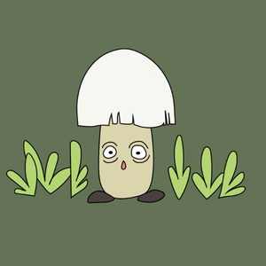

# Laura's Stickies




## Laura's Stickies is an open-source sticky note application based on Swift 

The app was inspired by macOS' native sticky note app, Stickies, but with more extensive customization options and rich text options such as bullet points and checklists. 


```
MyStickyNotes/
├── Package.swift            → The recipe: app name (StickyNotes), macOS 15, uses ColorTokensKit
├── make-app.sh              → Builds the finished version and wraps it into "Laura's Stickies.app"
├── LH.png                   → Your logo; make-app.sh turns it into the app icon
├── .gitignore               → Files git should NOT upload (.build, the .app, zips)
├── README.md                → The description people see on GitHub
│
└── Sources/
    ├── StickyNotesApp.swift*    → The starting point 
    │        │
    │        ├──▶ NoteStore.swift*    → The "notebook": keeps all notes
    │        │        └──▶ Note.swift*     → What ONE note is: text, theme, font, color, position
    │        │
    │        ├──▶ NotesCommands.swift → Menu bar items 
    │        │
    │        └──▶ FloatingWindow.swift → How windows appear on your desktop
    │
    ├── NoteView.swift            → What you see inside one note window 
    │        └──▶ RichTextEditor.swift 
    │
    ├── NoteStyle.swift           → Fonts and colors for each style 
    ├── ThemePickerView.swift     → The Theme window (uses ColorTokensKit)
    └── ChecklistView.swift       → not used anymore :/
```

## Citation
[1] ColorTokensKit: https://github.com/metasidd/ColorTokensKit-Swift

[2] Claude code for code corrections 
